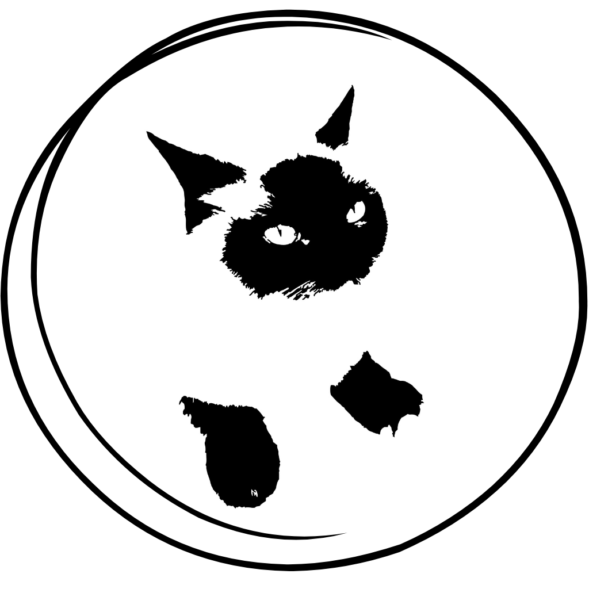

# SHAH CAT (SHAH)

**Small Cat. Infinite Worlds.**

SHAH CAT is a Solana-based meme token and an early-stage character-driven Web3 ecosystem project.

Our vision is to grow SHAH CAT into a globally recognized character brand with an engaged community, digital experiences, and sustainable services.

## Official Artwork

The official artwork preserves the original identity and distinctive silhouette of SHAH CAT.

## The SHAH CAT Universe

SHAH CAT is a small, mysterious black cat with the heart of a hero. Quiet and curious, SHAH explores new worlds and discovers extraordinary possibilities.

**Small Cat. Infinite Worlds.** represents the belief that even a small beginning can lead to an extraordinary journey.

## Token Development (Devnet)

- Blockchain: Solana
- Network: Devnet (testing only)
- Token name: SHAH CAT
- Symbol: SHAH
- Decimals: 9
- Verified test supply: 1,000,000,000 SHAH
- Devnet mint: `82Q5cipk2W2CM3CDizakXuZgrKS6WpK3zaDe7vqi6bh2`
- Metadata registration: Completed
- Mint authority: Development wallet (retained for testing)
- Freeze authority: None
- Wallet transfer test: 2,000 SHAH transferred successfully
- Mainnet token: Not launched

[View SHAH CAT on Solana Explorer](https://explorer.solana.com/address/82Q5cipk2W2CM3CDizakXuZgrKS6WpK3zaDe7vqi6bh2?cluster=devnet)

### Development Milestones

- [x] Create SPL token on Solana Devnet
- [x] Mint 1 billion test tokens
- [x] Register SHAH CAT metadata
- [x] Verify token supply and authority settings
- [x] Test token transfer to another wallet
- [ ] Document wallet security and token distribution
- [x] Build a Devnet token dashboard (Dashboard 2.0)
- [ ] Complete Mainnet readiness review
      
### Dashboard 2.0 — Release Gate 1 Complete

Status: Completed on October 22, 2026.

- Solana Devnet read-only dashboard
- Phantom wallet connect and disconnect
- SOL and SHAH wallet balance lookup
- Phantom account switching support
- Transfer input validation and preview only
- GitHub Actions CI: 61 tests passed, 0 failed
- Integrated into main via PR #3

Security boundaries:
- No wallet transaction signing
- No actual token transfers from the dashboard
- No private key or seed phrase collection
- No Mainnet deployment

Mainnet readiness review is still pending.

## Development Roadmap

### Track A — Brand and Community
- Establish the official character identity and brand guidelines
- Expand the SHAH CAT universe and storytelling
- Develop multilingual communication and community channels
- Explore original content, merchandise, and partnerships

### Track B — Technology and Ecosystem
- Complete Devnet token metadata and testing
- Review tokenomics, wallet security, and authority settings
- Evaluate legal and operational requirements before any mainnet launch
- Prototype community utilities and digital services
- Publish transparent project updates

## Project Status

SHAH CAT is in its early development and experimental stage. The Devnet token has no monetary value and is not a live investment product. Roadmap items are goals, not guaranteed deliverables.

## Official Repository

https://github.com/istars8370/shah-cat

---

SHAH CAT — Small Cat. Infinite Worlds.
