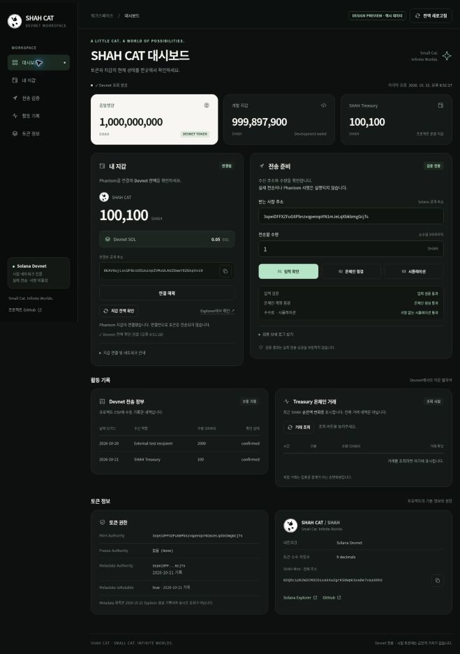

# SHAH CAT 대시보드 디자인 개선

검정·오프화이트 브랜드와 기존 고양이 로고를 살려, 잔액과 지갑 상태, 전송 검증 결과를 빠르게 읽을 수 있도록 화면을 정리했습니다.

## 디자인 미리보기

아래 화면의 잔액·연결·검증 결과는 **디자인 확인용 예시 데이터**입니다. 실제 지갑 조회나 실제 Devnet 시뮬레이션의 증거가 아닙니다. 예시 데이터를 넣은 내부 미리보기 코드는 이 변경에 포함하지 않습니다.



## 변경 내용

- 차콜 배경, 오프화이트 발행량 카드, 절제된 민트 포인트.
- 대시보드·내 지갑·전송 검증·활동 기록·토큰 정보 탐색 메뉴.
- 지갑과 전송 준비를 나란히 배치한 데스크톱 화면, 작은 화면의 단일 열 배치.
- 입력 확인·온체인 점검·시뮬레이션 결과 요약과 접을 수 있는 상세 로그.
- 지갑/Mint 전체 주소 복사, 브라우저 허용 대기·성공·실패 알림.
- 외부 이미지 요청 대신 저장소의 기존 공식 로고를 로컬 경로로 제공.
- 키보드 포커스, 본문 바로가기, 표 제목, 상태 알림, 동작 감소 설정 지원.

기존 `wallet.js`, `shared.js`, 전송 사전 점검과 시뮬레이션 모듈은 수정하지 않았습니다. `index.html`의 원래 데이터 조회 스크립트를 유지했고, 모든 기존 DOM ID를 보존했습니다. 서버에는 디자인 자산 세 경로만 추가했습니다.

## 기준 버전

첨부된 사용자 화면에 수수료 시뮬레이션이 있으므로 PR #6의 `feature/release-gate2-fee-simulation-20261022` 브랜치, 커밋 `0e8bb6d686ca428af5fb8498654d85d301868ba8`을 기준으로 합니다. 디자인 PR의 대상은 이 기능 브랜치입니다. PR #6의 승인이나 main 병합을 대신하지 않습니다.

## Windows에서 실행

1. `feature/dashboard-polish-20261022` 브랜치를 선택하고 **Code → Download ZIP**을 누릅니다.
2. 기존 폴더와 구별되는 새 폴더에 압축을 풉니다.
3. 새 폴더의 `dashboard` 폴더를 열고, 탐색기 주소창에 `cmd`를 입력합니다.
4. 기존 대시보드 서버가 4173 포트를 사용 중이면 그 명령창에서 `Ctrl+C`를 누릅니다.
5. 새 명령창에서 아래 명령을 실행합니다.

```cmd
node server.mjs
```

6. 브라우저에서 `http://127.0.0.1:4173`을 열고 필요하면 `Ctrl+Shift+R`로 새로고침합니다. 실행 중에는 명령창을 열어 둡니다.

추가 npm 패키지는 필요하지 않습니다. 원래의 읽기 전용 Devnet 동작과 실제 전송·Phantom 서명 비활성 상태를 유지합니다.

## 확인한 범위

- 기존 Node 테스트 104개 통과, 실패 0개. 로컬 서버가 필요한 여섯 smoke 테스트도 포함합니다.
- 서버와 추가 UI 스크립트의 문법 검사 통과.
- 기존 DOM ID 누락·중복 없음, 기존 inline 데이터 스크립트 일치 확인.
- 데스크톱과 390px 프레임의 반응형 레이아웃 및 로고 표시 확인.
- 예시 지갑으로 입력 검증·온체인 점검·시뮬레이션 요약, 0 수량 오류, 입력 변경 후 이전 결과 무효화, 상세 로그 펼침을 확인.

검증 환경에서 외부 Devnet RPC 조회는 `fetch failed`로 실패했습니다. 성공 화면의 시각 확인에는 명확히 표시한 예시 데이터를 사용했습니다. 실제 Phantom 확장 프로그램과 실제 잔액의 통합 동작은 사용자 PC에서 추가 확인해야 합니다. GitHub CI 결과는 해당 PR의 Checks에서 확인합니다.
