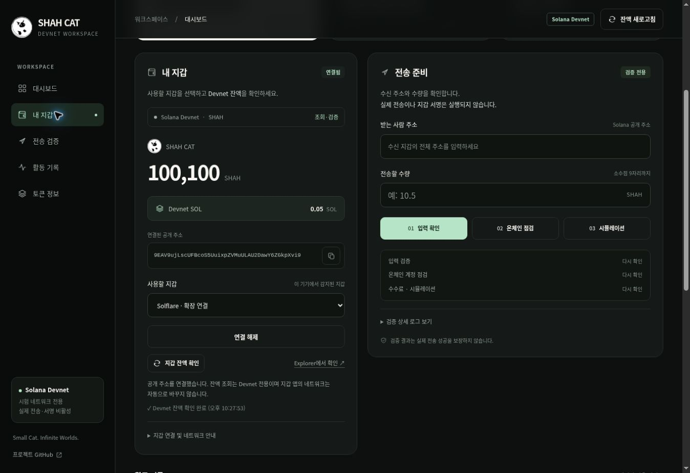

# SHAH CAT 지갑 호환성 기반 업데이트

현재 디자인에 여러 Solana 지갑을 선택하는 기능을 추가하고, 프로젝트 설정과 수량 계산을 분리합니다. 이 버전의 활성 자산은 **Solana Devnet의 SHAH**이며 공개 주소 연결, 잔액 조회, 전송 사전 점검과 서명 없는 시뮬레이션을 제공합니다.

## 사용하는 방법

1. 이 업데이트 브랜치 전체를 내려받아 새 폴더에 압축을 풉니다.
2. 기존 서버를 실행하던 명령창에서 `Ctrl+C`를 누릅니다.
3. 새 프로젝트의 `dashboard` 폴더에서 명령창을 열고 `node server.mjs`를 실행합니다.
4. `http://127.0.0.1:4173`을 열고 `Ctrl+Shift+R`로 새로고침합니다.
5. **사용할 지갑**에서 감지된 지갑을 선택하고 **지갑 연결**을 누릅니다.
6. 여러 Devnet 계정을 허용한 Wallet Standard 지갑은 **연결 계정**에서 계정을 선택할 수 있습니다.

Node.js 20 이상이 필요합니다. 별도의 npm 설치, CDN, API 키는 필요하지 않습니다. 실행 중에는 명령창을 열어 두어야 합니다. 기존 폴더에 일부 파일만 덮어쓰지 말고 전체 버전을 사용하세요.

## 지원 범위와 실제 확인 범위

| 경로 | 구현 범위 | 확인 방법 |
|---|---|---|
| Wallet Standard | 브라우저 등록 및 늦은 등록, Devnet 지원 계정, 연결·해제·계정 변경 | 프로토콜 모의 지갑 자동 테스트 |
| Phantom 확장 | 공개 주소 연결·해제·계정 변경 | 기존 회귀 테스트와 모의 확장 테스트 |
| Solflare 확장 | 공개 주소 연결·해제·계정 변경 | 모의 확장 테스트 |
| 실제 설치 지갑 | 기기·확장 버전별 연결 확인 필요 | 사용자 PC에서 지갑 선택과 잔액 조회 확인 |
| 모바일 | 모바일의 지갑 제공 환경에서 별도 검증 필요 | Android/iOS 각각 후속 확인 |

지갑 이름과 아이콘은 인증된 발행자 증명이 아닙니다. 같은 지갑의 표준 연결과 확장 연결이 모두 감지되면 경로를 구분해 표시합니다. 표준 지갑은 지갑과 계정이 `solana:devnet`을 지원해야 선택할 수 있습니다. 확장 연결은 지갑 앱의 네트워크를 자동 변경하지 않으며, 서버는 별도로 Devnet genesis를 확인합니다.

현재 서버는 로컬 PC용입니다. 이 업데이트에는 공개 웹사이트 배포, 모바일 앱 연결 경로, Mainnet 전송, Token-2022 전송, 스왑 또는 브리지가 포함되지 않습니다.

## 설정 구조

`dashboard/project-config.js`가 다음 공개 정보를 관리합니다. 비밀키와 시드 구문을 넣지 마세요.

- `PROJECT`: 이름, 심볼, 슬로건, 로고 경로.
- `NETWORK`: Devnet chain·cluster·genesis, 기본 RPC와 Explorer 주소.
- `TOKEN`: SHAH Mint, 소수점, 기존 SPL Token Program.
- `OWNERS`: 개발·Treasury 운영 지갑의 공개 주소와 역할.

`shared.js`는 브라우저와 Node에서 같은 설정을 검증합니다. Mainnet, 잘못된 genesis, Token-2022 및 알 수 없는 token program은 계속 거부합니다. 설정 파일을 바꾸는 것만으로 미지원 기능을 활성화할 수 없습니다. 환경변수 `SOLANA_RPC_URL`을 사용하는 경우에도 실제 RPC의 genesis 검사는 유지됩니다.

브라우저의 의존 순서는 `project-config.js → shared.js → wallet-connectors.js → wallet.js`입니다. 프로젝트·토큰의 주요 표시는 이 설정을 읽습니다. 수동 CSV 장부와 날짜가 붙은 메타데이터 점검 기록은 SHAH의 기존 기록이며 토큰 설정 변경으로 변환되지 않습니다.

## 정확한 수량 처리

- `parseAmount(text, decimals)`와 `amount(raw, decimals)`는 0~18자리 소수점과 uint64 범위 내 수량을 지원합니다.
- `solAmount(lamports)`는 토큰 설정과 무관하게 항상 SOL의 9자리를 사용합니다.
- 금액을 부동소수점으로 바꾸거나 초과 자릿수를 반올림하지 않습니다.
- 새로운 토큰 프로필은 Mint·프로그램·소수점·운영 지갑을 검토하고 별도 테스트한 다음 적용해야 합니다. 이 버전에는 다중 토큰 선택 UI나 임의 토큰 주소 입력 기능이 없습니다.

## 연결 변경 시 동작

지갑·계정 변경과 연결 해제 시 잔액과 전송 검증 결과를 초기화합니다. 오래된 비동기 응답은 새 계정의 결과를 덮어쓰지 않습니다. 사용자 연결 승인과 거래 서명을 구분하며, 이 버전은 거래 서명·메시지 서명·네트워크 전송 API를 호출하지 않습니다.

## 화면 확인

데스크톱과 좁은 화면에서 지갑 선택창의 배치를 확인했습니다. 아래 화면은 모의 지갑과 예시 잔액으로 확인한 화면이며 실제 지갑 연결 증빙이 아닙니다.



## 검증 명령

프로젝트 최상위 폴더에서 실행합니다.

```sh
node --test dashboard/*.test.mjs
```

이번 버전의 대시보드 자동 검사 175개가 모두 통과했습니다. 지갑 연결 검사는 26개이며 실제 설치 지갑 대신 모의 지갑으로 실행했습니다.

GitHub CI는 기존 Solana SDK와 거래 바이트를 대조하는 작업도 수행합니다. 자동·모의 지갑 테스트가 실제 PC 확장 프로그램 테스트를 대신하지는 않습니다.

## 참고한 공식 규격

- Wallet Standard: https://github.com/wallet-standard/wallet-standard
- 표준 앱 등록 이벤트: https://github.com/wallet-standard/wallet-standard/tree/master/packages/core/app
- Solana Wallet Standard: https://github.com/anza-xyz/wallet-standard
